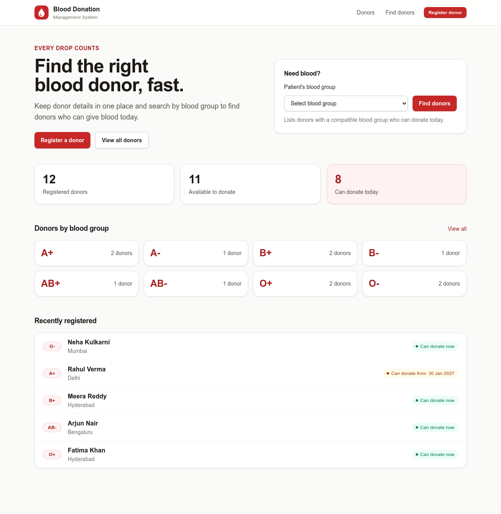

# Blood Donation Management System

A web app that keeps blood donor details and helps find suitable donors for a patient:
same or compatible blood group, available, and enough days since their last donation.

Built with **Java 17, Spring Boot 4, JSP, Tailwind CSS, Spring Data JPA and PostgreSQL**,
and deployed for free on **Vercel + Neon**.



## Documentation

| Document | What's inside |
|---|---|
| [docs/FEATURES.md](docs/FEATURES.md) | Every feature with screenshots, form rules and donation rules |
| [docs/PROJECT_DETAILS.md](docs/PROJECT_DETAILS.md) | Tech stack, architecture, folder structure, how the code works, database, tests, viva Q&A |
| [docs/DEPLOYMENT.md](docs/DEPLOYMENT.md) | Step-by-step guide to run it locally and deploy your own copy for free |
| [docs/DIAGRAMS.md](docs/DIAGRAMS.md) | Use case, class, sequence and activity diagrams, and DFD levels 0, 1 and 2 |

## Features at a glance

- Register, view, edit and delete donors
- Donors list with 10 donors per page, filterable by blood group
- Find suitable donors for a patient: compatible groups, city, "can donate today"
- Record a donation and see when the donor can donate again (90 days men / 120 days women)
- Mark donors as available or not available
- Dashboard with totals and donors per blood group
- Works on phones

## Quick start

Needs **Java 17 or newer**. Everything else downloads automatically.

```bash
./mvnw spring-boot:run
```

On Windows use `mvnw.cmd spring-boot:run`. Then open http://localhost:8080. It uses a
local H2 database with 12 made-up donors.

| Command | What it does |
|---|---|
| `./mvnw test` | Run the 27 tests |
| `./mvnw package` | Build `target/app.war` |
| `java -jar target/app.war` | Run the built app |
| `npm run watch:css` | Rebuild the CSS on every save while styling (needs Node.js) |

To put it online, follow [docs/DEPLOYMENT.md](docs/DEPLOYMENT.md).

## Tech stack

| Part | Technology |
|---|---|
| Language | Java 17 |
| Backend | Spring Boot 4.1 (Spring MVC, Spring Data JPA, Bean Validation) |
| Pages | JSP + JSTL, packaged as a WAR |
| Styling | Tailwind CSS 4 |
| Database | H2 (local), PostgreSQL on Neon (live), Flyway migrations |
| Build | Maven + Maven Wrapper |
| Hosting | Vercel (Docker container) + Neon |

## Project structure

```
src/main/java/com/group2/blooddonation/
├── controller/   web pages and form handling
├── service/      business logic (search, eligibility, statistics)
├── repository/   database queries (Spring Data JPA)
├── model/        Donor entity, BloodGroup and Gender enums
├── dto/          form and page data objects
├── exception/    404 handling
└── config/       sample data, web settings
src/main/resources/          settings, SQL migration, JavaScript, images
src/main/frontend/styles/    Tailwind CSS (base, layout, components, pages)
src/main/webapp/WEB-INF/     JSP pages and reusable JSP tags
docs/                        documentation, diagrams, screenshots
```

The full structure with explanations is in [docs/PROJECT_DETAILS.md](docs/PROJECT_DETAILS.md#3-folder-structure).
