# UML and DFD Diagrams

All diagrams for the Blood Donation Management System. Each picture is a PNG you can paste
into a report. Its editable source (`.puml`) is in [`diagrams/source`](diagrams/source).

| # | Diagram | Image |
|---|---|---|
| 1 | Use case diagram | [01-use-case.png](diagrams/images/01-use-case.png) |
| 2 | Class diagram: domain model | [02-class-domain.png](diagrams/images/02-class-domain.png) |
| 3 | Class diagram: application layers | [03-class-layers.png](diagrams/images/03-class-layers.png) |
| 4 | Sequence diagram: register a donor | [04-sequence-register-donor.png](diagrams/images/04-sequence-register-donor.png) |
| 5 | Sequence diagram: find suitable donors | [05-sequence-find-donors.png](diagrams/images/05-sequence-find-donors.png) |
| 6 | Sequence diagram: update availability and record a donation | [06-sequence-update-status.png](diagrams/images/06-sequence-update-status.png) |
| 7 | Activity diagram: register a donor | [07-activity-register-donor.png](diagrams/images/07-activity-register-donor.png) |
| 8 | Activity diagram: find suitable donors | [08-activity-find-donors.png](diagrams/images/08-activity-find-donors.png) |
| 9 | Activity diagram: manage a donor | [09-activity-donor-actions.png](diagrams/images/09-activity-donor-actions.png) |
| 10 | DFD Level 0 (context diagram) | [10-dfd-level-0.png](diagrams/images/10-dfd-level-0.png) |
| 11 | DFD Level 1 | [11-dfd-level-1.png](diagrams/images/11-dfd-level-1.png) |
| 12 | DFD Level 2: 1.0 Manage Donors | [12-dfd-level-2-manage-donors.png](diagrams/images/12-dfd-level-2-manage-donors.png) |
| 13 | DFD Level 2: 2.0 Update Donation Status | [13-dfd-level-2-donation-status.png](diagrams/images/13-dfd-level-2-donation-status.png) |
| 14 | DFD Level 2: 3.0 Search Donors | [14-dfd-level-2-search-donors.png](diagrams/images/14-dfd-level-2-search-donors.png) |

---

## 1. Use case diagram

Shows **who** uses the system and **what** they can do.

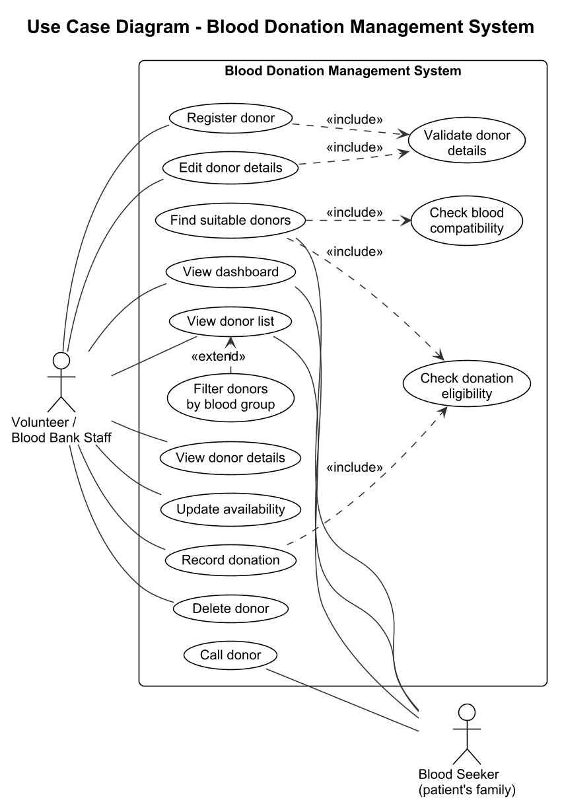

- **Actors:** *Volunteer / Blood Bank Staff* manages donor records. *Blood Seeker* (a
  patient's family) looks for donors.
- **«include»:** the included use case always runs as part of the other one. Registering
  and editing always *validate the details*. Finding donors always *checks blood
  compatibility* and *donation eligibility*.
- **«extend»:** *Filter donors by blood group* is an optional extra on *View donor list*.
- The app has no login yet, so in practice any visitor can use every use case.

---

## 2. Class diagrams

### 2.1 Domain model (`model` and `dto` packages)

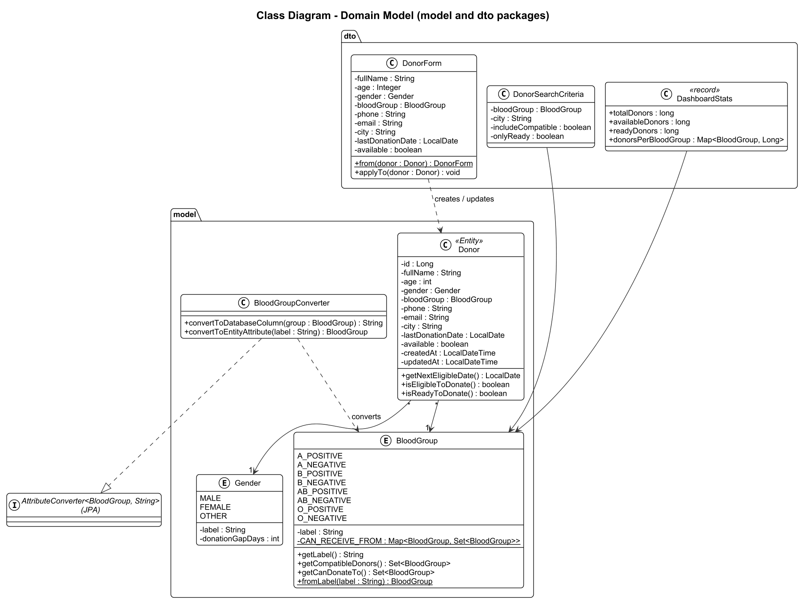

- **`Donor`** is the JPA entity stored in the `donors` table. Its methods work out whether
  the donor may donate.
- **`BloodGroup`** and **`Gender`** are enumerations. `BloodGroup` holds the compatibility
  rules in a `Map<BloodGroup, Set<BloodGroup>>`.
- **`BloodGroupConverter`** stores a blood group as `A+`, `O-` ... in the database.
- **`DonorForm`**, **`DonorSearchCriteria`** and **`DashboardStats`** are DTOs that carry
  data between the pages and the code.
- Notation: `-` private, `+` public, underlined = static, `*`/`1` = multiplicity.

### 2.2 Application layers

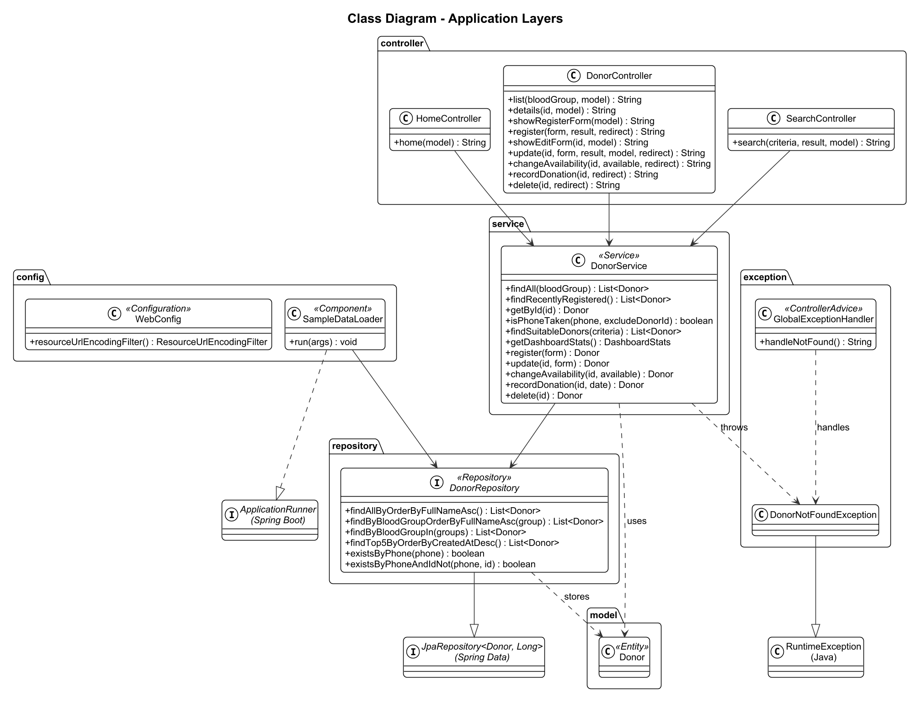

Controllers call `DonorService`, which calls `DonorRepository` (a Spring Data JPA interface).
`GlobalExceptionHandler` turns a `DonorNotFoundException` into the 404 page.
`SampleDataLoader` fills an empty database with made-up donors.

---

## 3. Sequence diagrams

Sequence diagrams show the messages between objects over time, from top to bottom.

### 3.1 Register a donor

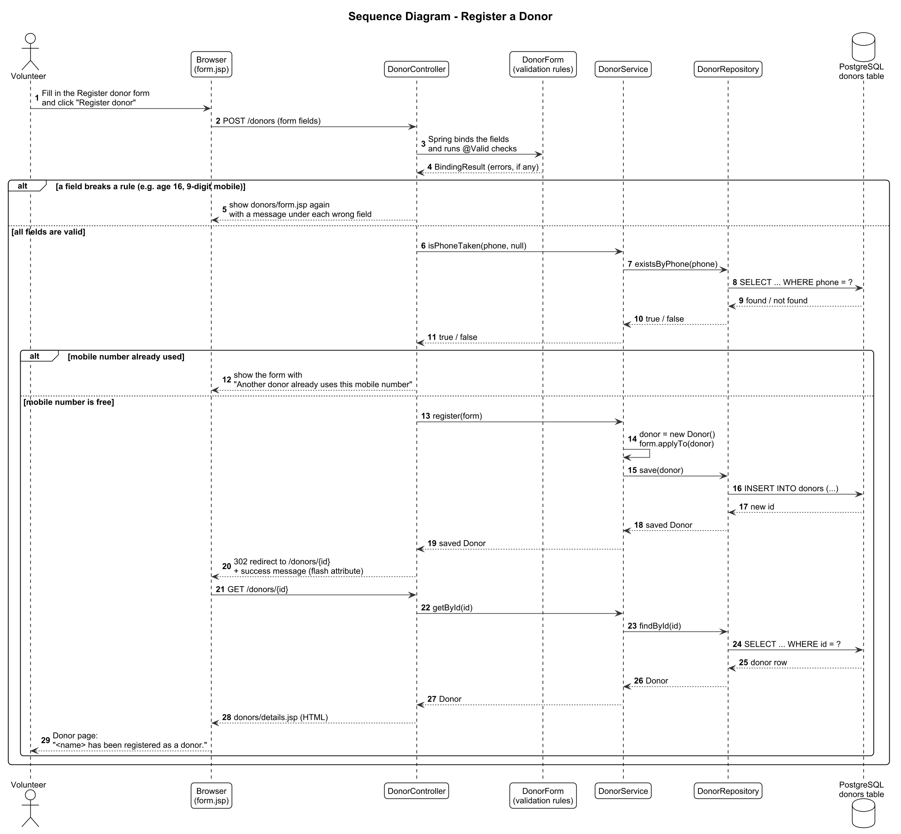

The form is validated first, then the mobile number is checked for duplicates, then the
donor is saved. The browser is redirected to the new donor's page (Post/Redirect/Get).

### 3.2 Find suitable donors

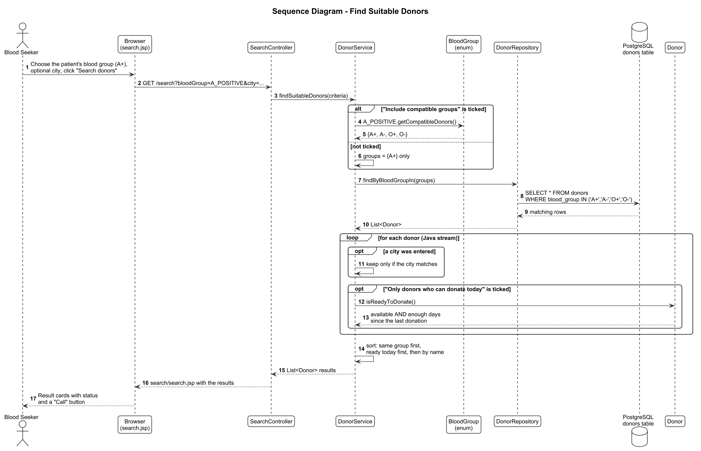

`BloodGroup` supplies the compatible groups. The repository fetches those donors in one
`SELECT ... IN (...)` query. The service then filters by city and readiness, and sorts the
best matches first.

### 3.3 Update availability and record a donation

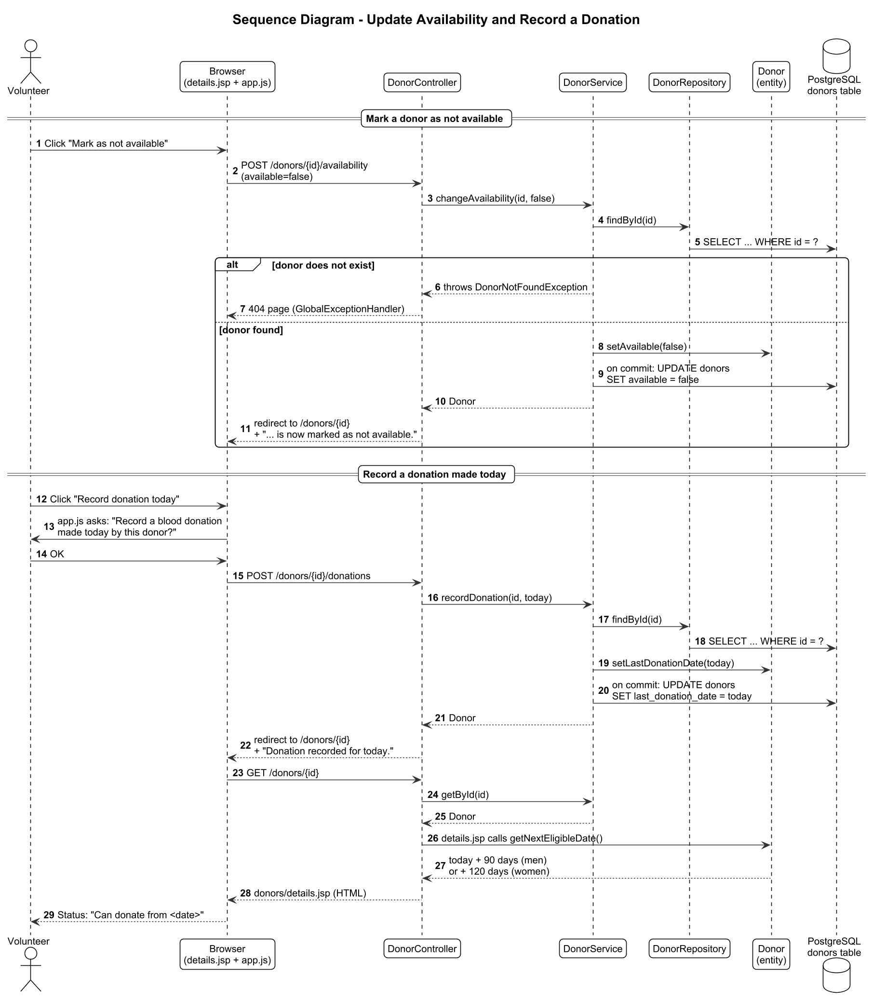

The service changes the loaded `Donor` object. Hibernate writes the `UPDATE` when the
transaction commits. An unknown donor id leads to the 404 page.

---

## 4. Activity diagrams

Activity diagrams show the flow of steps and decisions. Swimlanes show who does each step.

### 4.1 Register a donor

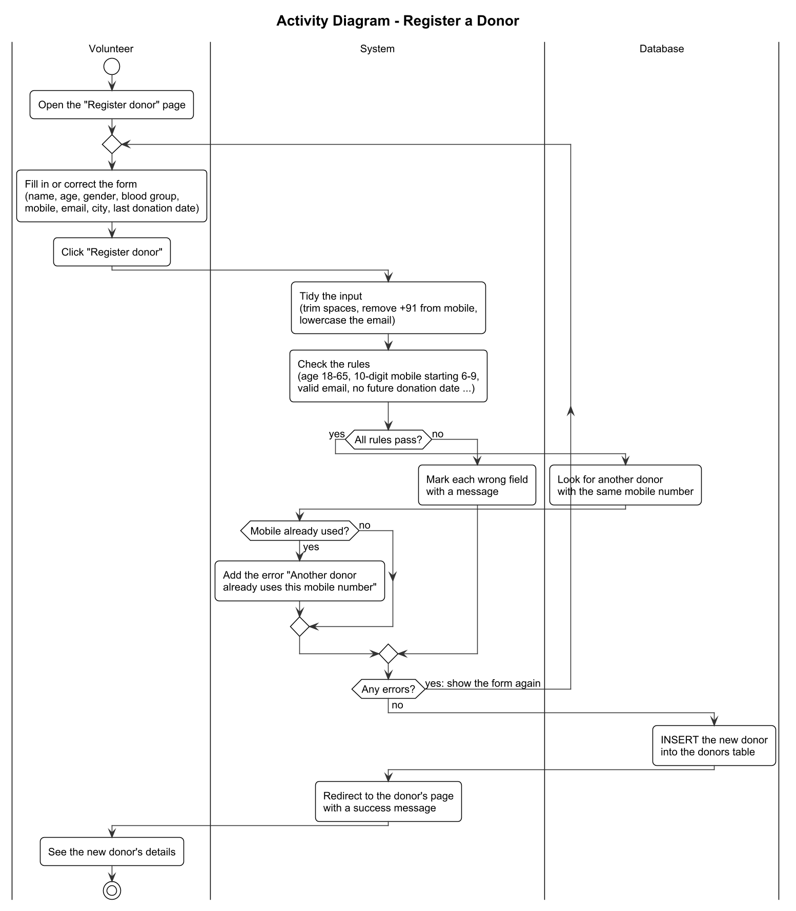

### 4.2 Find suitable donors

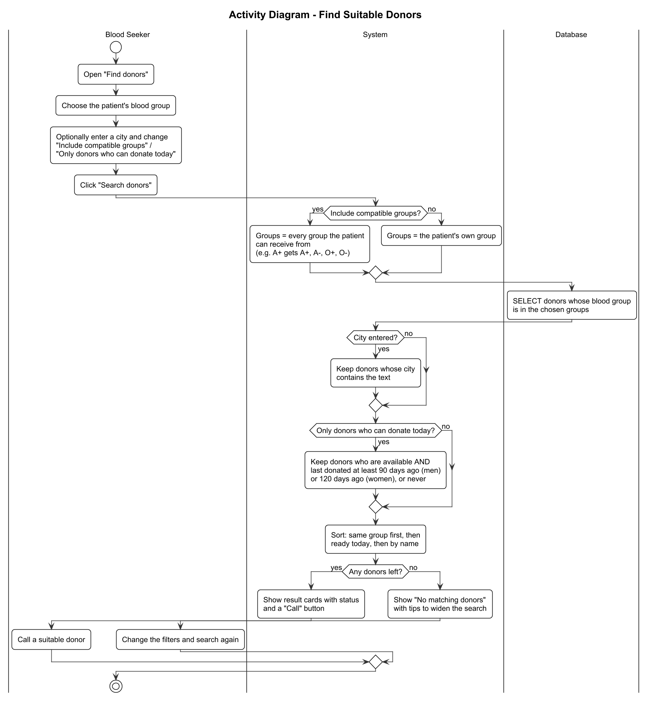

### 4.3 Manage a donor (donor page actions)

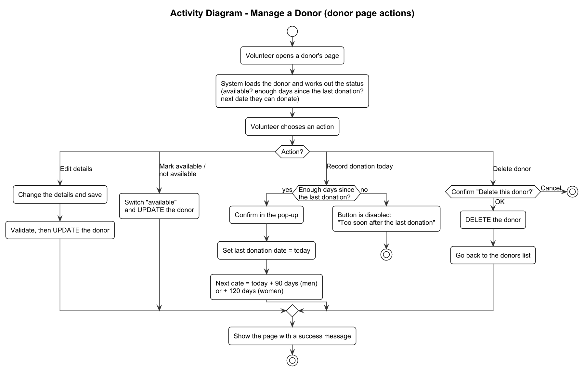

---

## 5. Data flow diagrams (DFD)

DFDs show how **data** moves through the system, not the order of steps.

| Symbol | Meaning |
|---|---|
| Rectangle (bold border) | External entity: a person outside the system |
| Oval with a number | Process: work the system does to data |
| Cylinder (D1, D2) | Data store: where data is kept |
| Labelled arrow | Data flow |

| Data store | What it is in the code |
|---|---|
| **D1 Donors** | The `donors` table (H2 on a computer, PostgreSQL online) |
| **D2 Blood Compatibility Rules** | The `CAN_RECEIVE_FROM` map in `BloodGroup.java` |

### 5.1 Level 0: context diagram

The whole system as one process, with the people who use it.

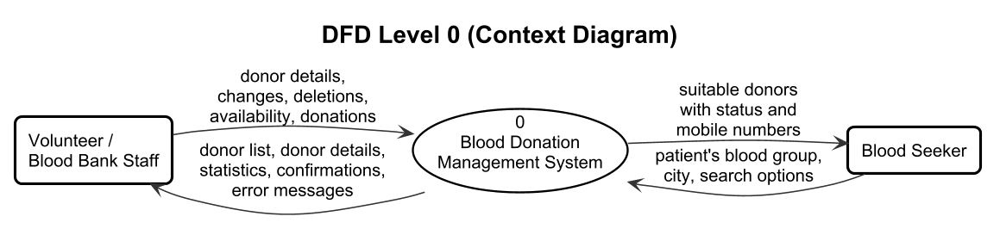

### 5.2 Level 1

The system split into its four main processes.

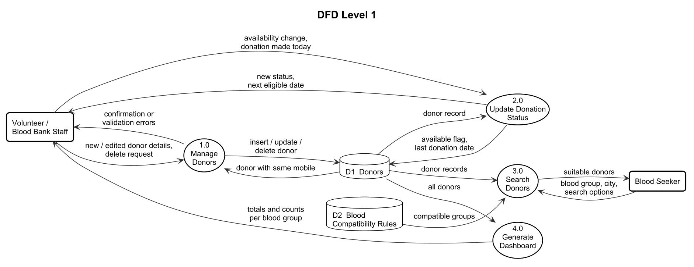

| Process | Covers |
|---|---|
| 1.0 Manage Donors | Register, edit, delete |
| 2.0 Update Donation Status | Availability and recording donations |
| 3.0 Search Donors | Blood group filter and Find suitable donors |
| 4.0 Generate Dashboard | Home page totals and per-group counts |

### 5.3 Level 2: 1.0 Manage Donors

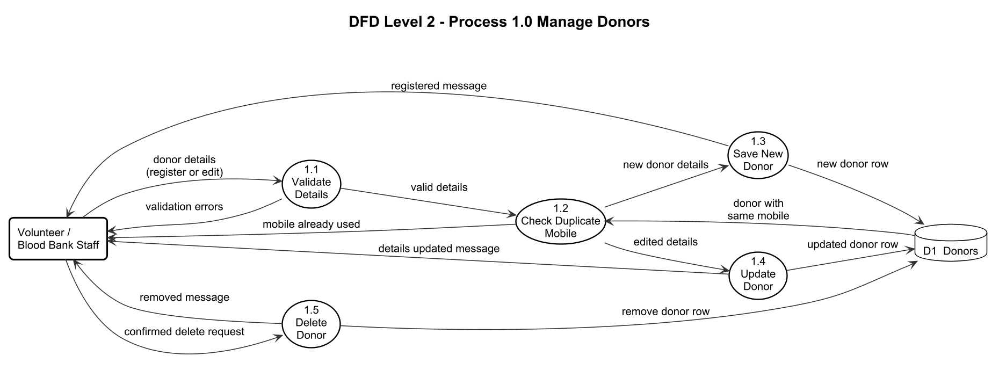

### 5.4 Level 2: 2.0 Update Donation Status

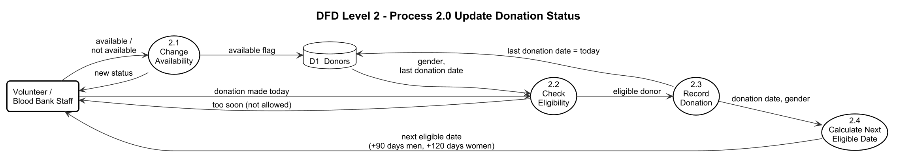

### 5.5 Level 2: 3.0 Search Donors

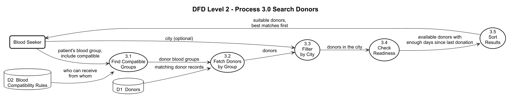

Process 4.0 Generate Dashboard is a single simple step (read all donors and count them), so
it isn't broken down further.

---

## Editing the diagrams

The diagrams are written in **PlantUML**, a text format. Change the `.puml` file, then turn
it back into a PNG in one of these ways:

- **Online:** paste the file's text into https://www.plantuml.com/plantuml and download the
  PNG. Copy the lines from `_style.iuml` (and `_dfd-style.iuml` for DFDs) in place of the
  `!include` line.
- **VS Code / IntelliJ:** install the "PlantUML" extension and use its preview/export.
- **Command line** (needs Java): download `plantuml.jar` from https://plantuml.com/download, then
  from the `docs/diagrams` folder run:
  ```bash
  java -jar plantuml.jar -tpng -o ../images source/*.puml
  ```

The shared style (`_style.iuml`) uses the plain black-and-white theme and PlantUML's
built-in layout engine, so nothing else (such as Graphviz) needs installing.
