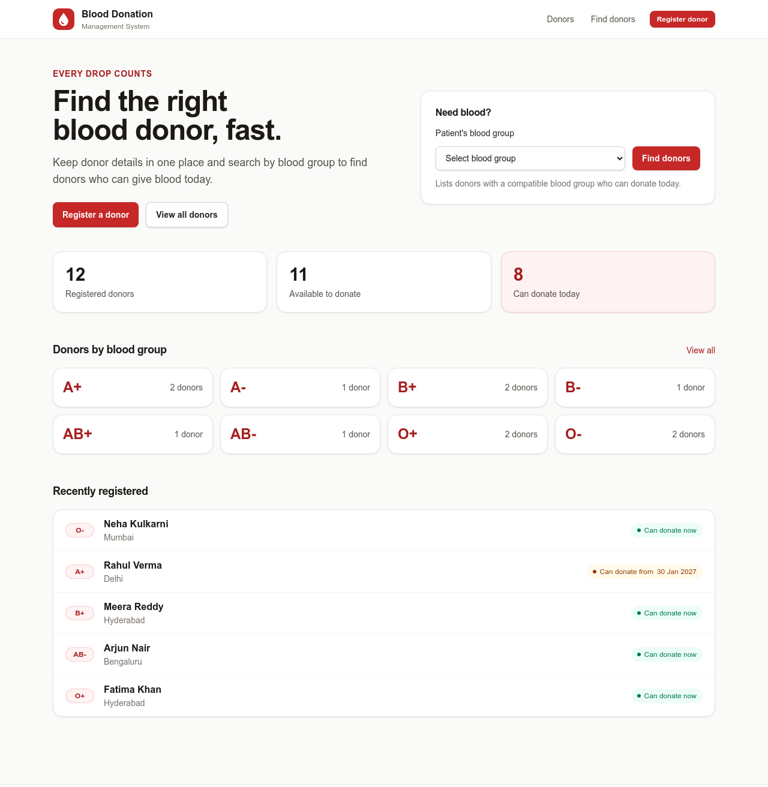
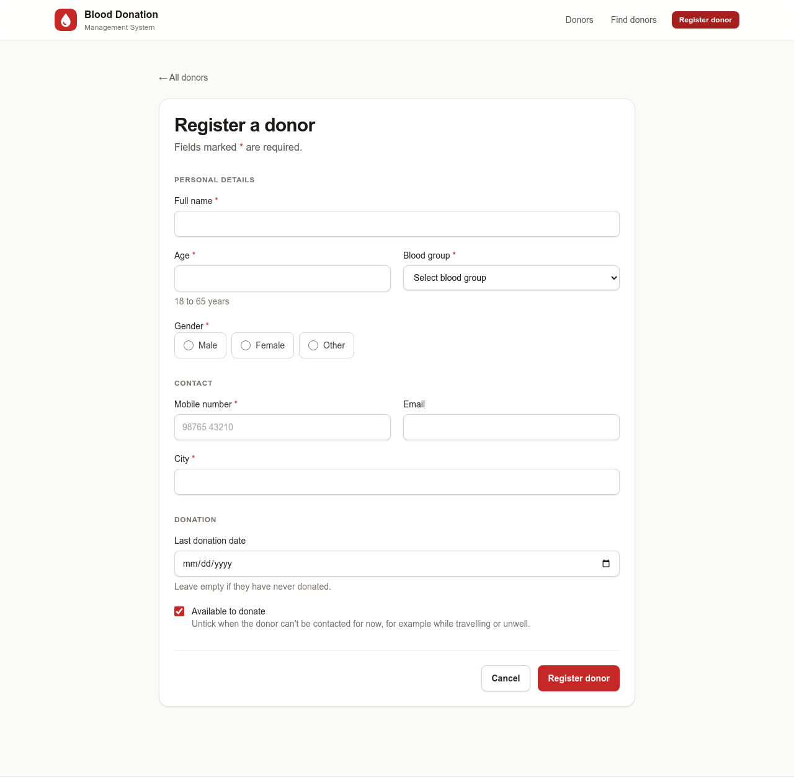
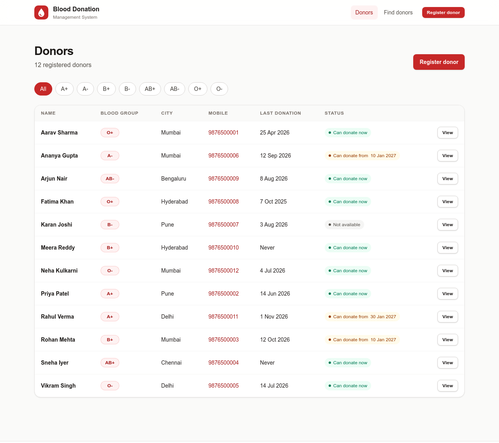
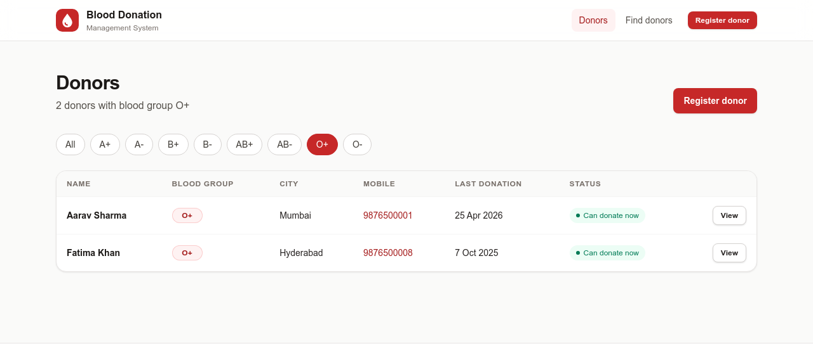
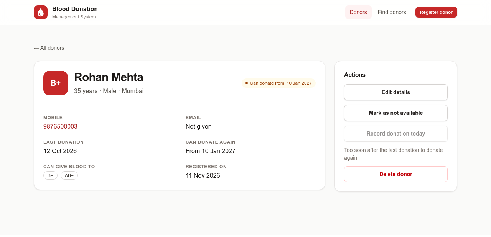
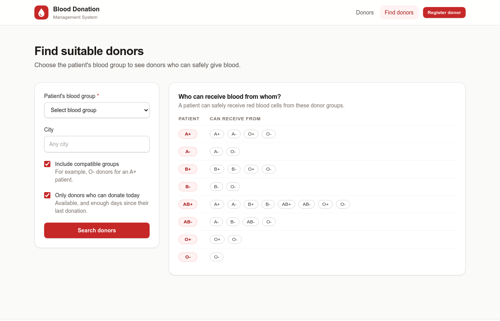
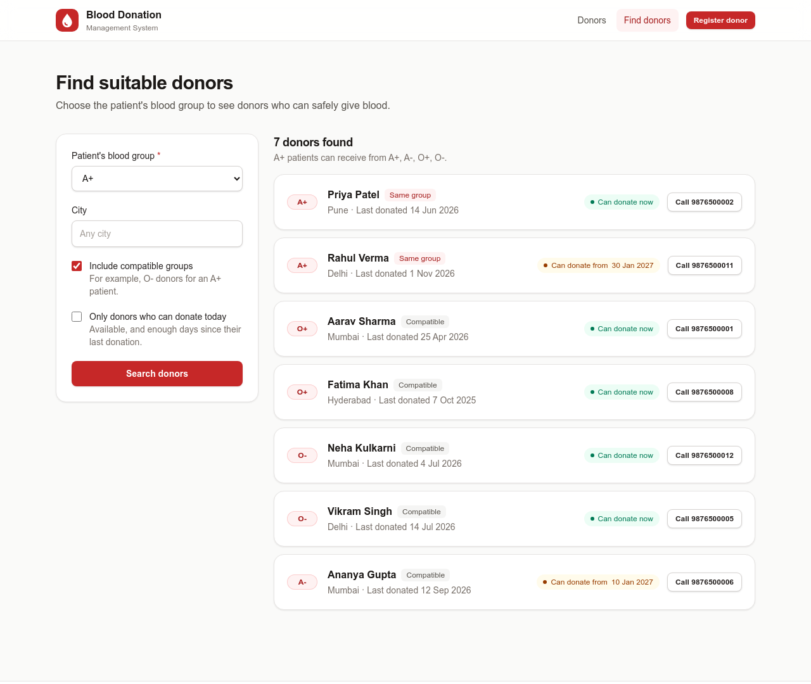
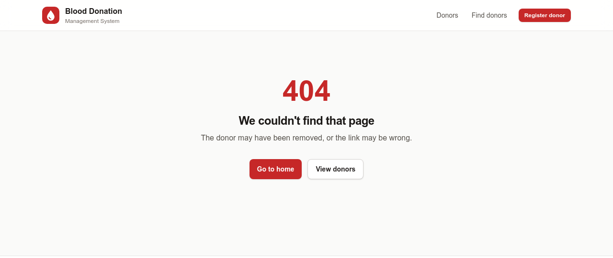
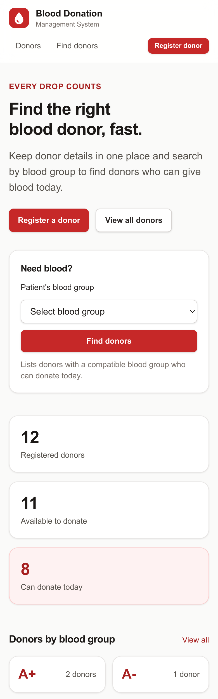
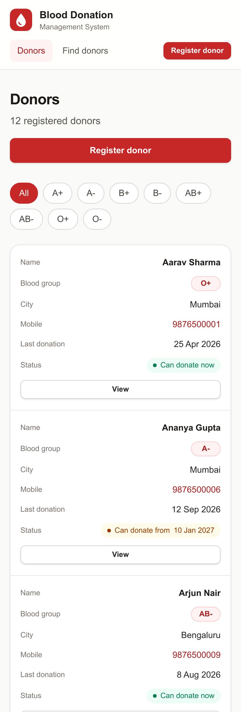

# Features

The Blood Donation Management System keeps a list of blood donors and helps find the right
donor for a patient quickly. This guide walks through every feature, what it does, and the
rules behind it.

**Who uses it**

- **Volunteer / blood bank staff:** register donors, keep their details up to date, record
  donations and mark who is available.
- **Blood seeker (a patient's family):** search for donors who can give blood to the patient
  and call them.

There is no login yet, so anyone who opens the site can use every feature (see
[Not included yet](#14-not-included-yet)).

## Contents

1. [Home page (dashboard)](#1-home-page-dashboard)
2. [Register a donor](#2-register-a-donor)
3. [View donors and filter by blood group](#3-view-donors-and-filter-by-blood-group)
4. [Donor details page](#4-donor-details-page)
5. [Edit donor details](#5-edit-donor-details)
6. [Update availability](#6-update-availability)
7. [Record a donation](#7-record-a-donation)
8. [Delete a donor](#8-delete-a-donor)
9. [Find suitable donors](#9-find-suitable-donors)
10. [Donation rules used](#10-donation-rules-used)
11. [Error pages](#11-error-pages)
12. [Works on phones](#12-works-on-phones)
13. [Sample data](#13-sample-data)
14. [Not included yet](#14-not-included-yet)

---

## 1. Home page (dashboard)

**Address:** `/`

| Part | What it shows |
|---|---|
| **Need blood?** box | Pick the patient's blood group and click **Find donors** to jump straight to the search results |
| **Registered donors** | Every donor in the system |
| **Available to donate** | Donors who said they are willing to donate |
| **Can donate today** | Available donors who are also allowed to donate today (enough days since their last donation) |
| **Donors by blood group** | One tile per blood group with its donor count. Click a tile to see those donors |
| **Recently registered** | The 5 newest donors with their status |

---

## 2. Register a donor

**Address:** `/donors/new` (the **Register donor** button in the top bar)

| Field | Required | Rule |
|---|---|---|
| Full name | Yes | Up to 100 characters. Extra spaces are removed |
| Age | Yes | 18 to 65 years |
| Gender | Yes | Male, Female or Other (decides the gap between donations) |
| Blood group | Yes | One of A+, A-, B+, B-, AB+, AB-, O+, O- |
| Mobile number | Yes | 10 digits starting with 6, 7, 8 or 9. You can type `98765 43210`, `98765-43210` or `+91 98765 43210`: spaces, dashes and `+91` are removed. **No two donors can share a number** |
| Email | No | Must look like an email address. Saved in lowercase |
| City | Yes | Up to 60 characters |
| Last donation date | No | Can't be in the future. Leave it empty if they have never donated |
| Available to donate | No | Ticked by default. Untick if the donor can't be contacted for now |

**How checking works**

1. **In the browser:** the browser stops the form if a required field is empty.
2. **On the server:** every rule above is checked again (the browser check can be skipped,
   the server check can't). Any problem is shown in red under that field, for example
   *"Donors must be at least 18 years old"* or *"Another donor already uses this mobile number"*.

After saving, you land on the new donor's page with the message
**"&lt;name&gt; has been registered as a donor."**

---

## 3. View donors and filter by blood group

**Address:** `/donors`, or `/donors?bloodGroup=O_POSITIVE` for one group

- **List:** every donor, sorted by name, with blood group, city, mobile number, last donation
  date and status.
- **Filter by blood group:** click a chip (**A+**, **O-** ...) to show only that group, or
  **All** to show everyone. The chip you picked turns red and the heading says how many
  donors match.
- **Call:** tap a mobile number on a phone to call the donor.
- **View:** opens the donor's page.
- **Empty list:** if nobody matches, a message with a **Register a donor** button is shown.

---

## 4. Donor details page

**Address:** `/donors/{id}`, for example `/donors/3`

Shows everything about one donor:

| Item | Meaning |
|---|---|
| Blood group, name, age, gender, city | Basic details |
| Status badge | See the table below |
| Mobile, email | Contact details (tap to call or email) |
| Last donation | Date of the last donation, or *Never donated* |
| Can donate again | *Now*, or the first date they may donate again |
| Can give blood to | The patient blood groups this donor's blood is safe for |
| Registered on | When the donor was added |

**Status badges** (used on every page)

| Badge | Colour | Meaning |
|---|---|---|
| **Can donate now** | Green | Available, and enough days have passed since the last donation (or they never donated) |
| **Can donate from &lt;date&gt;** | Amber | Available, but donated too recently. Shows the first allowed date |
| **Not available** | Grey | Marked as not available by a volunteer |

The **Actions** box on the right holds features 5 to 8.

---

## 5. Edit donor details

**Address:** `/donors/{id}/edit` (**Edit details** button)

The same form as registration, already filled in. The same rules apply. The mobile number
only has to be different from *other* donors' numbers. After saving you see
**"Donor details updated."**

---

## 6. Update availability

**Button:** **Mark as not available** / **Mark as available**

Switches the donor between available and not available with one click, for example while
they are travelling or unwell. Not-available donors are left out of
"Can donate today" counts and search results (unless you choose to see everyone).
Message: **"&lt;name&gt; is now marked as available / not available."**

---

## 7. Record a donation

**Button:** **Record donation today**

1. Click the button and confirm the pop-up *"Record a blood donation made today by this donor?"*.
2. The donor's last donation date becomes today.
3. Their status changes to **Can donate from &lt;date&gt;**: today + 90 days for men, or
   + 120 days for women and Other.

If the donor donated too recently, the button is greyed out with the note
*"Too soon after the last donation to donate again."*

---

## 8. Delete a donor

**Button:** **Delete donor** (red)

Asks *"Delete this donor? This can't be undone."* first. After deleting you go back to the
donors list with the message **"&lt;name&gt; has been removed."**

---

## 9. Find suitable donors

**Address:** `/search` (**Find donors** in the top bar)

Before you search, the page shows a table of who can receive blood from whom:

**Search options**

| Option | Default | What it does |
|---|---|---|
| Patient's blood group | (required) | The blood group of the person who needs blood |
| City | Any city | Only donors whose city contains this text (`mum` finds Mumbai and Navi Mumbai) |
| Include compatible groups | On | Also list donors of other safe groups, for example O- donors for an A+ patient |
| Only donors who can donate today | On | Hide donors who are not available or donated too recently |

**Results**

- **Sorted best first:** donors of the *same* group come first, then donors who can donate
  today, then alphabetically by name.
- **Match label:** each card says **Same group** or **Compatible**.
- **Call button:** each card has a **Call** button with the donor's number.
- **No matches:** the page suggests turning on compatible groups, clearing the city, or
  showing donors who can't donate today.

---

## 10. Donation rules used

**Age:** donors must be 18 to 65 years old.

**Gap between whole-blood donations** (India's NBTC guidelines):

| Gender | Minimum gap |
|---|---|
| Male | 90 days |
| Female | 120 days |
| Other | 120 days (the longer gap, to be safe) |

**Who can receive red blood cells from whom:**

| Patient's group | Can receive from |
|---|---|
| A+ | A+, A-, O+, O- |
| A- | A-, O- |
| B+ | B+, B-, O+, O- |
| B- | B-, O- |
| AB+ | Everyone (universal receiver) |
| AB- | A-, B-, AB-, O- |
| O+ | O+, O- |
| O- | O- only |

O- donors can give to every patient (universal donor). The donor page shows this the other
way round, under **Can give blood to**.

---

## 11. Error pages

- **Page not found (404):** shown for a wrong link, a deleted donor, or an address like
  `/donors/abc`.
- **Something went wrong (500):** shown if the server hits an unexpected error. Technical
  details are never shown to visitors on the live site.

---

## 12. Works on phones

Every page adjusts to small screens: the menu moves under the logo, forms become one
column, and the donors table turns into one card per donor.

| Home on a phone | Donors on a phone |
|---|---|
|  |  |

---

## 13. Sample data

So the pages aren't empty, the app can add **12 made-up donors** (all 8 blood groups, different
cities, some who donated recently, one not available) when the database is empty.

- **On your computer:** switched on automatically.
- **On the live site:** off, unless you set `APP_SAMPLE_DATA=true` in Vercel (see
  [DEPLOYMENT.md](DEPLOYMENT.md)).

The phone numbers are made up (`98765000xx`). Don't put real people's numbers on a public demo.

---

## 14. Not included yet

Good points to mention as **future scope** in a viva:

- **Login and roles:** today anyone with the link can add, edit or delete donors. An admin
  login (Spring Security) would protect these actions.
- **Notifications:** SMS, WhatsApp or email alerts to suitable donors.
- **Paging:** the donors list shows everyone on one page, which is fine for hundreds of
  donors but not for thousands.
- **Donation history:** only the *last* donation date is kept, not every donation.
- **Blood stock:** tracking units of blood in a blood bank, not just donors.
